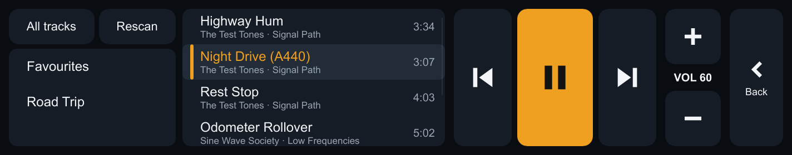

# Impala OS

Offline-first car infotainment for a 2008 Chevrolet Impala, running on a
Raspberry Pi 4 with a 6.9" 1424×280 ultrawide touchscreen. It's written in
Rust with a Slint UI, and MPD plays the audio.




**Milestone 1 (this repo today):**
- Local music playback through MPD, controlled by touch.
- The same `Command` path is ready for steering-wheel CAN and voice input.
- MPD restarts, missing files and the network going away are all handled
  without a crash.

| Doc | Contents |
|---|---|
| [docs/DEPLOY.md](docs/DEPLOY.md) | Exact build, run, test and deploy commands |
| [docs/ARCHITECTURE.md](docs/ARCHITECTURE.md) | Crates, data flow, interface boundaries for CAN, voice, navigation and Navidrome |
| [docs/PI-CHANGES.md](docs/PI-CHANGES.md) | Every system change made on the Pi, and how to undo it |
| [docs/TESTING.md](docs/TESTING.md) | Tests run, results, limitations, blockers |
| [docs/LIVI.md](docs/LIVI.md) | LIVI (CarPlay/Android Auto) evaluation and recommendation |
| [docs/M2-PLAN.md](docs/M2-PLAN.md) | Milestone 2: Navidrome/OpenSubsonic and offline caching |

## Layout

```
crates/impala-core   commands, state, backend trait, mock backend, player service (no I/O)
crates/impala-mpd    MPD protocol client with reconnect/backoff
crates/impala-ui     the `impala` binary: Slint UI, --screenshot, --headless
ui/                  Slint markup (main.slint)
config/              impala.toml (app), mpd.conf (MPD), deploy.env.example
services/            systemd units (optional autostart, MPD drop-in)
scripts/             deploy, Pi setup, test-audio generator, install
tests/               on-Pi end-to-end and offline test scripts
docs/                documentation and screenshots
```

## Quick start (desktop)

```bash
cargo test --workspace
cargo run -p impala-ui -- --mock
```

```bash
cargo run -p impala-ui -- --mock --screenshot preview.png
```
